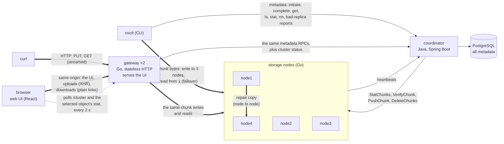

# object-store

A distributed object store in the style of S3, built from scratch: Go storage nodes, a Java/Spring Boot coordinator, gRPC and Protocol Buffers, PostgreSQL, and a React/TypeScript UI that shows the cluster heal in real time.

**Live:** https://objectstore.ayomideo.dev (password-protected; contact me for access)

**Highlights**
- **Never overstates durability:** an upload commits only after the coordinator confirms with the nodes themselves that every chunk has at least 2 fsynced, checksum-verified copies.
- **Self-healing:** heartbeat-based failure detection, then node-to-node re-replication back to 3 copies. The coordinator never carries object bytes.
- **Every byte served is verified:** a download that can't be verified fails visibly instead of completing, checked end to end through the production proxy setup (the deployed Caddy version and site block) over HTTP/1.1, HTTP/2 and HTTP/3.
- **137 mutation tests:** each one deliberately breaks a rule, and a named test must catch it. Acceptance scripts crash, pause and corrupt real nodes.
- **Diagnosed a grpc-java bug and built the way out:** a node channel stuck for good after the node's IP changed, traced from a failed acceptance run to a known, still-unfixed upstream issue; the coordinator now detects the stuck channel and replaces it ([DECISIONS.md](DECISIONS.md#a-node-channel-that-isnt-ready-within-half-the-calls-deadline-is-replaced-only-that-replacement-is-rate-limited-stage-11)).

Clients upload objects under a key; each object is split into 4 MiB chunks, every chunk is checksummed and replicated to three of four storage nodes, and a coordinator keeps all metadata in PostgreSQL.

The core rule: **the metadata plane and the data plane are separate.** The coordinator decides where bytes go and records what exists; clients and storage nodes move the bytes between themselves.


The recording above is [`scripts/demo.sh`](scripts/demo.sh) running on the shipped configuration (idle time compressed to 2 s). Replay it in a terminal with `asciinema play docs/demo.cast`.

## Architecture



Thick arrows carry object bytes; thin ones carry metadata only. The gateway is just another client (invariant 11): it runs the same upload and download code as `osctl`, through the same RPCs, and keeps nothing between requests. The browser UI is just another client of the gateway.

**Life of a put:** the coordinator creates a `PENDING` object and picks 3 ALIVE nodes per chunk. The client streams each chunk to its 3 nodes, which verify its SHA-256 and write it durably (fsync, link without replacing, fsync the directory). At CompleteUpload the coordinator asks the nodes what they hold and commits only if every chunk has at least 2 confirmed replicas, swapping the key's pointer in the same transaction.

**Life of a get:** the client reads each chunk from one healthy replica; the node verifies it before sending a byte and the client checks it again. On an error or a mismatch it fails over to the next replica and reports the bad copy, which the coordinator marks `BAD` only if the node confirms.

**In the background:** nodes heartbeat every 2 s and go `SUSPECT` after 6 s of silence, `DEAD` after 15 s. A reconciler copies under-replicated chunks node to node, idempotent and bounded. `rm` removes the key at once; GC deletes the files after a read grace, and collects abandoned `PENDING` uploads.

The full walkthrough is in [docs/architecture.md](docs/architecture.md).

## Invariants

These hold at every stage after the one that introduced them; code that would break one is wrong even if its tests pass.

1. **No partial reads.** A key resolves only to a `COMMITTED` object. A Postgres foreign key makes the key pointer reference only committed objects.
2. **Commit implies durability.** An object commits only if every chunk has at least 2 replicas that acknowledged a checksum-verified, fsynced write, as confirmed by the nodes themselves.
3. **Metadata never overstates.** A replica row exists only for a replica that acknowledged, and facts about a node come only from a response that identifies as that node.
4. **Chunks are immutable.** A chunk file is never modified in place (writes link without replacing); chunk IDs are assigned by the coordinator and never reused. Deleted IDs are tombstoned.
5. **Every byte served is verified.** Nodes check a chunk's SHA-256 before sending it to a client or a peer.
6. **The coordinator carries no object bytes.** Re-replication is node to node.
7. **Postgres is the only metadata truth.** Restarting the coordinator loses nothing.
8. **Re-replication is idempotent and bounded.** Running it twice is harmless; copies in flight are capped cluster-wide and per node.
9. **Wire compatibility.** Protobuf field numbers are never reused or renumbered (`buf breaking` in CI).
10. **arm64-clean.** Every image builds and runs on `linux/arm64` ([`scripts/check-arm64.sh`](scripts/check-arm64.sh)).
11. **The gateway is just a client.** It holds no state between requests and runs the same shared upload and download code as `osctl`, through the same RPCs.

## Quick start

You need Docker (with Compose v2), Go 1.27, and Python 3 for the scripts; Node 24 only for working on the web UI and running its tests (the gateway image builds the UI itself).

```sh
docker compose up --build --wait   # Postgres, the coordinator, 4 nodes, 2 gateways
make build                         # bin/osctl, bin/node and bin/gateway

bin/osctl put ./photo.jpg photos/1.jpg
bin/osctl get photos/1.jpg ./copy.jpg
bin/osctl ls photos/
bin/osctl stat photos/1.jpg        # chunks, replicas, liveness
bin/osctl rm photos/1.jpg

open http://127.0.0.1:9081/        # the web UI (or 9082)
scripts/demo.sh                    # the demo above, about two minutes
```

Every port is bound to 127.0.0.1: there is no authentication. `osctl` talks to `127.0.0.1:9090` unless `OSCTL_COORDINATOR` says otherwise; the gateways listen on `127.0.0.1:9081` and `127.0.0.1:9082`. All configuration is environment variables, documented in [`docker-compose.yml`](docker-compose.yml). Reset everything with `docker compose down -v`.

## More

- [docs/architecture.md](docs/architecture.md): the full life of a put and a get, and liveness, repair and GC.
- [docs/gateway.md](docs/gateway.md): the HTTP API, key encoding, status codes and the gateway's bounds.
- [docs/web-ui.md](docs/web-ui.md): what the UI shows, with screenshots, and how to develop it.
- [docs/testing.md](docs/testing.md): the test layers, every acceptance script, verdicts, mutation checks and the demo.
- [DEPLOY.md](DEPLOY.md): deploying to one VM behind Caddy, and what any other deployment must provide.
- [DECISIONS.md](DECISIONS.md): every non-obvious choice: what was chosen, over what, why, and when it would become wrong. A few worth reading first:
  - [Client fan-out writes](DECISIONS.md#client-fan-out-writes-per-replica-writer-in-a-shared-package-stage-4) rather than a primary that forwards to replicas
  - [A commit quorum of 2 of 3](DECISIONS.md#commit-quorum-at-least-2-verified-replicas-per-chunk-else-failed_precondition-stage-4)
  - [The node's durable, no-replace write path](DECISIONS.md#node-write-path-temp--fsync--link-no-replace--fsync-dir--unlink-temps-cleaned-before-listening-stage-3)
  - [A bad-replica report is a hint the node must confirm](DECISIONS.md#a-clients-bad-replica-report-is-a-hint-the-node-confirms-it-before-anything-is-marked-stage-5)
  - [Repair waits a grace period after DEAD](DECISIONS.md#repair-waits-a-grace-period-after-dead-stage-7)
  - [Tombstones, a check after the link, and a sweep at startup](DECISIONS.md#tombstones-on-the-node-a-check-after-the-link-a-sweep-at-startup-stage-8)
  - [Garbage collection always makes progress](DECISIONS.md#gc-bounds-gc_passes-and-v7-stage-8)
  - [How the gateway aborts a download that fails mid-stream](DECISIONS.md#get-sends-headers-with-the-first-verified-chunk-flushes-per-chunk-aborts-mid-stream-stage-10)
  - [The gateway's memory limit, and what the first stress run got wrong](DECISIONS.md#gateway-memory-limit-from-worst-case-bounds-stage-10)
  - [Liveness events are logged off the liveness path](DECISIONS.md#liveness-transitions-are-logged-off-the-liveness-path-and-may-be-dropped-stage-11)
  - [Host allowlist against DNS rebinding](DECISIONS.md#host-allowlist-on-every-route-the-health-probe-sends-an-allowed-host-stage-11)
  - [Browser tests wait on states, never on time](DECISIONS.md#browser-tests-wait-on-states-never-on-time-stage-11)

## Out of scope

Coordinator high availability or consensus, S3 API compatibility (the gateway has its own simple API), authentication and encryption, erasure coding, deduplication, compression, versioning beyond atomic overwrite, range reads, resumable uploads, rack awareness, rebalancing, background scrubbing, fencing tokens, multi-region. [CLAUDE.md](CLAUDE.md) has the full list and the build plan.

## Repo layout

```
proto/objectstore/v1/   the wire format (the only source of truth)
coordinator/            Java 25, Spring Boot, grpc-java; Flyway migrations
node/                   storage node (Go): cmd/node, internal/chunkstore, internal/server
client/                 osctl (Go): cmd/osctl
gateway/                HTTP gateway (Go): cmd/gateway, internal/httpapi, internal/webui (the embedded UI)
web/                    the browser UI: React + TypeScript + Vite; e2e/ holds the Playwright tests
internal/upload/        a whole upload (initiate, fan-out writes, complete), shared by osctl and the gateway
internal/download/      a whole download (failover, verified streaming, reports), shared likewise
internal/chunkwrite/    per-replica chunk writer shared by the uploads and the nodes' copies
gen/go/                 generated Go code (committed)
scripts/                demo, acceptance, mutation and deployment scripts
deploy/                 Caddy's site block for the deployment (DEPLOY.md)
docs/                   architecture, gateway, web UI and testing docs; the demo recording and UI screenshots
DECISIONS.md            every design decision
DEPLOY.md               deploying to one VM behind Caddy
docker-compose.prod.yml the production override (DEPLOY.md)
```
