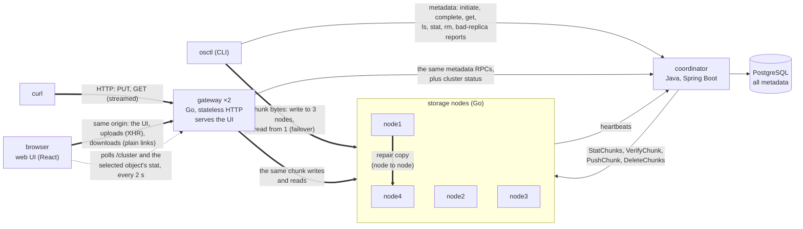
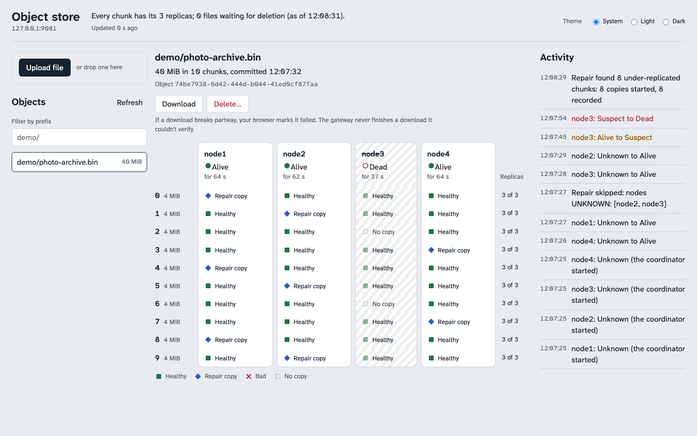

# object-store

A small S3-style distributed object store. Clients upload objects under a key; each object is split into 4 MiB chunks, every chunk is checksummed and replicated to three of four storage nodes, and a coordinator keeps all metadata in PostgreSQL. It tracks node liveness through heartbeats and re-replicates chunks that lose a replica. Clients are a CLI (`osctl`), a stateless HTTP gateway (`curl`, or anything that speaks HTTP), and a browser UI the gateway serves, which shows where every chunk lives and watches the cluster heal.

The core rule: **the metadata plane and the data plane are separate.** The coordinator decides where bytes go and records what exists. It never carries object bytes: clients and storage nodes move them between themselves.


The recording above is [`scripts/demo.sh`](scripts/demo.sh) running on the shipped configuration (idle time compressed to 2 s). Replay it in a terminal with `asciinema play docs/demo.cast`.

## Architecture



Thick arrows carry object bytes; thin ones carry metadata only. The gateway is just another client (invariant 11): it runs the same upload and download code as `osctl`, through the same RPCs, and keeps nothing between requests. The browser UI is just another client of the gateway.

**Life of a put**
1. `osctl put` asks the coordinator to initiate an upload. The coordinator creates a `PENDING` object and plans its chunks: an ID and 3 ALIVE nodes each.
2. The client streams each chunk to its 3 nodes in parallel, in frames of at most 1 MiB, with the chunk's SHA-256.
3. Each node verifies size and hash, writes a temp file, fsyncs it, links it to its final name (never replacing anything) and fsyncs the directory.
4. The client calls CompleteUpload. The coordinator asks each node what it holds (`StatChunks`, answered under the node's own ID), records only the replicas that check out, and commits only if every chunk has at least 2.
5. Commit swaps the key's pointer to the new object in the same transaction. Readers see the old version or the new one, never a mix.

**Life of a get**
1. `osctl get` asks the coordinator for the chunk list: each chunk's hash and its healthy replicas, with each node's liveness.
2. For each chunk the client reads one replica (ALIVE nodes first). The node verifies the chunk before sending a byte, and the client checks the received bytes against the recorded hash.
3. On an error, a timeout or a hash mismatch, the client fails over to the next replica. A bad copy is reported; the coordinator asks that node to verify its own copy and marks it `BAD` only if the node confirms.

**In the background**
- **Liveness:** nodes heartbeat every 2 s. After 6 s of silence a node is `SUSPECT`, after 15 s `DEAD`; it needs 2 consecutive beats to come back.
- **Repair:** a reconciler finds chunks with fewer than 3 healthy replicas (a `DEAD` node's copies stop counting 30 s after it died) and orders a node-to-node copy from a verified replica. It is idempotent and bounded.
- **Garbage collection:** `rm` removes the key at once; the object's files are deleted after a read grace, and uploads left `PENDING` are abandoned and collected. A row is removed only when the node itself confirms its file is gone.

## Run it

You need Docker (with Compose v2), Go 1.27, and Python 3 for the scripts; Node 24 only for working on the web UI and running its tests (the gateway image builds the UI itself).

```sh
docker compose up --build --wait   # Postgres, the coordinator, 4 nodes, 2 gateways
make build                         # bin/osctl, bin/node and bin/gateway

bin/osctl put ./photo.jpg photos/1.jpg
bin/osctl get photos/1.jpg ./copy.jpg
bin/osctl ls photos/
bin/osctl stat photos/1.jpg        # chunks, replicas, liveness
bin/osctl rm photos/1.jpg
```

Every port is bound to 127.0.0.1: there is no authentication. `osctl` talks to `127.0.0.1:9090` unless `OSCTL_COORDINATOR` says otherwise; the gateways listen on `127.0.0.1:9081` and `127.0.0.1:9082`. All configuration is environment variables, documented in [`docker-compose.yml`](docker-compose.yml).

Reset everything with `docker compose down -v`.

## The HTTP gateway

Two identical, stateless gateways (ports 9081 and 9082) serve the same objects: what one stores, the other serves, and restarting either loses nothing.

```sh
curl -T ./photo.jpg   http://127.0.0.1:9081/objects/photos%2F1.jpg        # PUT
curl -o copy.jpg      http://127.0.0.1:9082/objects/photos%2F1.jpg        # GET, from the other gateway
curl                  http://127.0.0.1:9081/objects/photos%2F1.jpg/stat   # chunks and replicas
curl                 'http://127.0.0.1:9081/objects?prefix=photos%2F&limit=100'
curl -X DELETE        http://127.0.0.1:9081/objects/photos%2F1.jpg
curl                  http://127.0.0.1:9081/cluster                       # liveness, repair, GC
```

- **A key is one path segment.** Encode `/` in a key as `%2F` (`encodeURIComponent`), and a key that is exactly `.` or `..` as `%2E`. A raw slash gets 400 with that rule. This keeps `/objects/{key}/stat` unambiguous.
- **PUT needs `Content-Length`** (411 without one, chunked included) and is capped at 5 GiB (413). Both are checked before the body is sent. The body is streamed: the gateway holds one 4 MiB chunk per upload, and the client hanging up or stalling for 30 s means nothing commits.
- **GET streams verified chunks only.** The status line goes out with the first verified chunk, so a failure before that is a proper status. A failure after it aborts the connection: the client sees a short body and a broken transfer (`curl: (18)`), never a complete-looking response.
- **Listing is paged by key:** `start_after` and `limit` (default and maximum 1000) in, `next_start_after` out, empty on the last page.
- **Status codes:** 400 bad request, 404 no such key, 503 with `Retry-After` when the cluster or the gateway is busy or short of nodes, 500 when a chunk has no healthy replica, 502 or 504 when upstream fails. Errors are JSON, `{"error": ..., "code": ...}`.
- **Bounds:** 8 uploads and 16 downloads at once per gateway (more get 503 at once), a 384 MiB container limit derived from those caps, and no whole-request timeout. A transfer is cut off only if it stops moving for `GATEWAY_STALL_TIMEOUT`.

## The web UI

Open <http://127.0.0.1:9081/> (or 9082) once the stack is up.



*Above: during `scripts/demo.sh`, the stopped node is Dead (its bay hatched from card to last slot), and the chunks it held have been copied into the other bays as ◆ repair copies. The feed shows it going Suspect, then Dead, and the repair pass that found its chunks under-replicated. Also: [the same moment in the dark theme](docs/ui-demo-repair-dark.png), and [after the demo's corrupt step](docs/ui-demo-repaired.png), with a Bad copy whose chunk has been repaired, and the node back with its old copies (4, target 3).*

- **Placement:** pick an object and every chunk is a row and every node a column (a bay). Each copy shows as ■ Healthy, ◆ Repair copy, ✕ Bad, or a dotted No copy, with the word next to the glyph, and each row says how many copies count toward the 3-replica target, by the reconciler's own rule.
- **Cluster:** node cards with their liveness (● Alive, ◐ Suspect, ○ Dead, for how long), a sentence with the under-replicated and pending-deletion counts, and an activity feed of liveness transitions and repair and cleanup passes. It polls every 2 s while the tab is visible.
- **Objects:** upload (button or drag and drop, with progress), download, list by prefix with paging, stat, and delete with a confirmation.
- **Observe-only:** nothing in the UI stops a node, starts a pass or changes the cluster.
- **Accessible:** every state is a glyph and a word (never colour alone), everything works from the keyboard with a visible focus ring, light and dark themes, and reduced motion respected.

Things worth knowing:
- Keys `.` and `..` can't be reached from any browser (the URL parser removes those path segments, even encoded), so the UI won't upload them and lists them as osctl-only.
- A download is a plain link: the browser streams it to disk. If it breaks partway the browser marks it failed; the gateway never completes a download it couldn't verify.
- `GATEWAY_ALLOWED_HOSTS` lists the `host:port` names the gateway answers to; any other Host gets 403 (against DNS rebinding). Add any other name you reach it by.

**Developing the UI:** `cd web && npm ci && npm run dev` serves it on <http://127.0.0.1:5173> with hot reload, proxying the API to a running gateway (`GATEWAY=http://127.0.0.1:9082` to pick the other one). `npm test`, `npm run lint` and `npm run typecheck` are the fast checks. `make web` builds it into the gateway's embed directory for a local `bin/gateway`; without that, `go build` still works and `/` answers 503 "web UI not built". The gateway image always builds it.

## The demo

```sh
docker compose down -v && docker compose up --build --wait
make build
scripts/demo.sh
```

About two minutes, on the shipped settings. It uploads a 40 MiB file, stops a node (SUSPECT, then DEAD), waits out the repair grace and shows each chunk being copied, starts the node again, corrupts one replica on disk and downloads the file intact anyway (the replica is marked `BAD` and the chunk repaired), and ends with `osctl stat`.

The demo is also an acceptance test: every step checks that what it shows happened and stops with `FAIL` and the reason if not. `DEMO_PAUSE=5 scripts/demo.sh` holds 5 s after each step; with the UI open on `/?key=demo%2Fphoto-archive.bin` you can watch it happen. `scripts/record-demo.sh` records it (needs `asciinema` 3 and `agg`).

## Invariants

These hold at every stage after the one that introduced them; code that would break one is wrong even if its tests pass.

1. **No partial reads.** A key resolves only to a `COMMITTED` object. A Postgres foreign key makes the key pointer reference only committed objects.
2. **Commit implies durability.** An object commits only if every chunk has at least 2 replicas that acknowledged a checksum-verified, fsynced write, as confirmed by the nodes themselves.
3. **Metadata never overstates.** A replica row exists only for a replica that acknowledged, and facts about a node come only from a response that identifies as that node.
4. **Chunks are immutable.** A chunk file is never modified in place (writes link without replacing); chunk IDs are assigned by the coordinator and never reused. Deleted IDs are tombstoned.
5. **Every byte served is verified.** Nodes check a chunk's SHA-256 before sending it to a client or a peer.
6. **The coordinator carries no object bytes.** Re-replication is node to node.
7. **Postgres is the only metadata truth.** Restarting the coordinator loses nothing.
8. **Re-replication is idempotent and bounded.** Running it twice is harmless; copies in flight are capped cluster-wide and per node.
9. **Wire compatibility.** Protobuf field numbers are never reused or renumbered (`buf breaking` in CI).
10. **arm64-clean.** Every image builds and runs on `linux/arm64` ([`scripts/check-arm64.sh`](scripts/check-arm64.sh)).
11. **The gateway is just a client.** It holds no state between requests and runs the same shared upload and download code as `osctl`, through the same RPCs.

## How it's tested

| Layer | What | Run |
|---|---|---|
| Go unit tests | node chunk store (durability order, tombstones, crash recovery), node RPCs, heartbeats, client upload and failover; gateway handlers against a fake coordinator and fake nodes (411/413, key encoding, the error mapping, the caps, streaming both ways, the mid-stream abort, disconnects and stalls, the Host and cross-origin checks, Content-Disposition, the embedded UI's headers, the health probe) | `go test ./...` |
| Coordinator integration tests | 118 tests against a real Postgres (Testcontainers) and in-process fake nodes: the commit protocol, bad-replica reports, liveness, repair, GC, listing pagination, the node address set, cluster status and its cache, per-chunk counted replicas, the liveness event log (including a failing and a hanging event store) | `cd coordinator && ./gradlew test` |
| Web unit tests | Vitest: key encoding, the grid derivation, upload messages, the poller (no overlap, paused when hidden, backoff), the feed, keys rendered as text; plus lint rules that keep keys out of markup and object bytes out of JavaScript | `cd web && npm test && npm run lint` |
| Browser tests | Playwright against the real stack: the UI follows `demo.sh` (Suspect, Dead, repair, Bad, repaired), browser and `osctl` round trips both ways, paging and delete, a corrupted replica, a broken download | `scripts/stage11-ui-check.sh` |
| Acceptance scripts | one per stage, against the real Compose stack; each checks what actually happened on disk and in Postgres, and fails as inconclusive rather than passing on a run that didn't test anything | below |
| Mutation checks | each patch in `scripts/mutations/` breaks one rule; the named test (or lint rule) must fail | `scripts/go-mutation-check.sh`, `scripts/coordinator-mutation-check.sh`, `scripts/web-mutation-check.sh` |

| Script | Proves |
|---|---|
| `stage2-roundtrip.sh`, `stage2-overwrite-check.sh` | 0 B / 1 B / 4 MiB / 100 MiB round trips; a get during overwrites sees the old or the new object, never a mix |
| `stage3-corrupt-check.sh`, `stage3-crash-check.sh`, `stage3-fsync-trace.sh` | a flipped byte fails the get loudly; a node killed mid-write leaves no partial file; the fsync order, traced |
| `stage4-replication-check.sh` | 3 replicas per chunk; uploads with a node stopped or hung; clean failure with too few nodes |
| `stage5-failover-check.sh` | reads fail over and the bad replica is marked, only on its node's word |
| `stage6-liveness-check.sh` | ALIVE → SUSPECT → DEAD → ALIVE within the configured windows |
| `stage7-repair-check.sh` | every chunk of a stopped node gets back to 3 replicas; a target killed mid-copy leaves nothing partial |
| `stage8-gc-check.sh` | after a client is killed mid-upload, no orphan chunk files remain; rm, overwrite and GC with a node down |
| `stage10-gateway-check.sh` | curl round trips; 411 and 413; a later chunk corrupt on every replica gives a broken transfer with exactly the verified prefix; two gateways and a restart; overwrite, rm, ls and stat match `osctl` in both directions |
| `stage11-ui-check.sh` | on a fresh stack, the browser suite above; a foreign Host gets 403 on every route and a cross-origin DELETE deletes nothing; both gateways healthy with the allowlist set |
| `demo.sh` | the demo story, end to end |

Scripts that corrupt files restore them afterwards and check that every file they touched is gone or verifies. A mutation counts as detected when its named test fails (for the coordinator, in a run of only that test's class); each script then runs the full unmutated suite once. CI runs the Go, coordinator and web unit tests on every push, and the acceptance scripts and the three mutation checks weekly.

## Design decisions

Every non-obvious choice is recorded in [DECISIONS.md](DECISIONS.md): what was chosen, over what, why, and when it would become wrong. A few worth reading first:

- [Client fan-out writes](DECISIONS.md#client-fan-out-writes-per-replica-writer-in-a-shared-package-stage-4) rather than a primary that forwards to replicas
- [A commit quorum of 2 of 3](DECISIONS.md#commit-quorum-at-least-2-verified-replicas-per-chunk-else-failed_precondition-stage-4)
- [The node's durable, no-replace write path](DECISIONS.md#node-write-path-temp--fsync--link-no-replace--fsync-dir--unlink-temps-cleaned-before-listening-stage-3)
- [A bad-replica report is a hint the node must confirm](DECISIONS.md#a-clients-bad-replica-report-is-a-hint-the-node-confirms-it-before-anything-is-marked-stage-5)
- [Repair waits a grace period after DEAD](DECISIONS.md#repair-waits-a-grace-period-after-dead-stage-7)
- [Tombstones, a check after the link, and a sweep at startup](DECISIONS.md#tombstones-on-the-node-a-check-after-the-link-a-sweep-at-startup-stage-8)
- [Garbage collection always makes progress](DECISIONS.md#gc-bounds-gc_passes-and-v7-stage-8)
- [How the gateway aborts a download that fails mid-stream](DECISIONS.md#get-sends-headers-with-the-first-verified-chunk-flushes-per-chunk-aborts-mid-stream-stage-10)
- [The gateway's memory limit, and what the first stress run got wrong](DECISIONS.md#gateway-memory-limit-from-worst-case-bounds-stage-10)
- [Liveness events are logged off the liveness path](DECISIONS.md#liveness-transitions-are-logged-off-the-liveness-path-and-may-be-dropped-stage-11)
- [Host allowlist against DNS rebinding](DECISIONS.md#host-allowlist-on-every-route-the-health-probe-sends-an-allowed-host-stage-11)
- [Browser tests wait on states, never on time](DECISIONS.md#browser-tests-wait-on-states-never-on-time-stage-11)

## Before deploying

Nothing is deployed yet. The shipped Compose file is the development and demo stack; a deploy (for example to a single small ARM VM) would need:

- **A real Postgres password:** set `OBJECTSTORE_DB_PASSWORD` (copy `.env.example` to `.env`).
- **Production GC timings:** the shipped `COORDINATOR_GC_READ_GRACE` (60 s) and `COORDINATOR_GC_PENDING_TIMEOUT` (120 s) are demo values; use the code defaults, 15 min and 24 h.
- **Ports kept on loopback:** with no authentication, reach the services through an SSH tunnel. Drop or remap Postgres's host port (5432) if the host runs another Postgres; only the scripts use it.
- **Memory:** every service has a hard limit, about 4.25 GiB in total, derived from worst-case bounds and checked by saturating each cap (see DECISIONS.md, stages 9 and 10).
- **The gateways have no authentication either:** keep them on loopback too. Behind a reverse proxy, make sure it passes `%2F` in paths through undecoded, or keys with slashes stop resolving, and add the name it uses to `GATEWAY_ALLOWED_HOSTS`, or every request gets 403. The UI's delete is protected against cross-site requests and DNS rebinding, not against anyone who can reach the port.
- **Watching costs:** each open UI tab polls every 2 s. The coordinator caches the expensive counts for `COORDINATOR_STATUS_CACHE_TTL` (1 s), so the scan behind them runs at most once a second however many tabs watch; it still grows with the number of chunks.
- **Restart policies and log rotation:** none are set (the crash tests stop nodes on purpose); add `restart: unless-stopped` and json-file `max-size` for a long-running host.
- **Backups:** Postgres is the only metadata truth, and the coordinator is a single point of failure by design. Schedule `pg_dump`.

## Out of scope

Coordinator high availability or consensus, S3 API compatibility (the gateway has its own simple API), authentication and encryption, erasure coding, deduplication, compression, versioning beyond atomic overwrite, range reads, resumable uploads, rack awareness, rebalancing, background scrubbing, fencing tokens, multi-region. [CLAUDE.md](CLAUDE.md) has the full list and the build plan.

## Repo layout

```
proto/objectstore/v1/   the wire format (the only source of truth)
coordinator/            Java 25, Spring Boot, grpc-java; Flyway migrations
node/                   storage node (Go): cmd/node, internal/chunkstore, internal/server
client/                 osctl (Go): cmd/osctl
gateway/                HTTP gateway (Go): cmd/gateway, internal/httpapi, internal/webui (the embedded UI)
web/                    the browser UI: React + TypeScript + Vite; e2e/ holds the Playwright tests
internal/upload/        a whole upload (initiate, fan-out writes, complete), shared by osctl and the gateway
internal/download/      a whole download (failover, verified streaming, reports), shared likewise
internal/chunkwrite/    per-replica chunk writer shared by the uploads and the nodes' copies
gen/go/                 generated Go code (committed)
scripts/                demo, acceptance and mutation scripts
docs/                   the demo recording and UI screenshots
DECISIONS.md            every design decision
```
