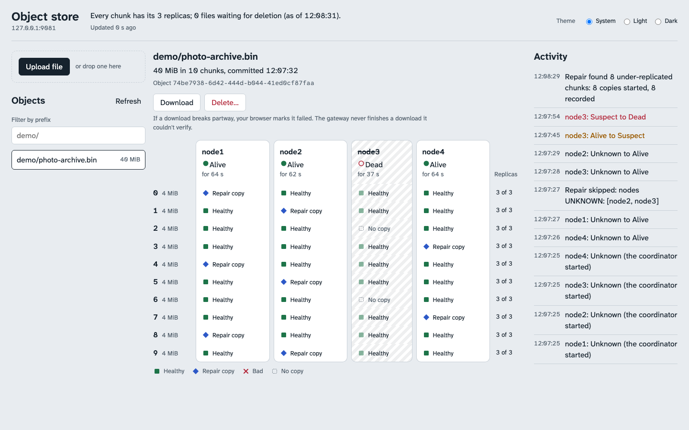

# The web UI

The browser UI the gateways serve: what it shows, what's worth knowing about it, and how to work on it. It's the same origin as the API and only observes the cluster.

Open <http://127.0.0.1:9081/> (or 9082) once the stack is up ([quick start](../README.md#quick-start)).

*Above: during `scripts/demo.sh`, the stopped node is Dead (its bay hatched from card to last slot), and the chunks it held have been copied into the other bays as ◆ repair copies. The feed shows it going Suspect, then Dead, and the repair pass that found its chunks under-replicated. Also: [the same moment in the dark theme](ui-demo-repair-dark.png), and [after the demo's corrupt step](ui-demo-repaired.png), with a Bad copy whose chunk has been repaired, and the node back with its old copies (4, target 3).*

- **Placement:** pick an object and every chunk is a row and every node a column (a bay). Each copy shows as ■ Healthy, ◆ Repair copy, ✕ Bad, or a dotted No copy, with the word next to the glyph, and each row says how many copies count toward the 3-replica target, by the reconciler's own rule.
- **Cluster:** node cards with their liveness (● Alive, ◐ Suspect, ○ Dead, for how long, and "Alive, but unreachable" when the coordinator's own calls to a node are failing), a sentence with the under-replicated and pending-deletion counts, and an activity feed of liveness transitions and repair and cleanup passes. It polls every 2 s while the tab is visible.
- **Objects:** upload (button or drag and drop, with progress), download, list by prefix with paging, stat, and delete with a confirmation.
- **Observe-only:** nothing in the UI stops a node, starts a pass or changes the cluster.
- **Accessible:** every state is a glyph and a word (never colour alone), everything works from the keyboard with a visible focus ring, light and dark themes, and reduced motion respected.

Things worth knowing:
- Keys `.` and `..` can't be reached from any browser (the URL parser removes those path segments, even encoded), so the UI won't upload them and lists them as osctl-only.
- A download is a plain link: the browser streams it to disk. If it breaks partway the browser marks it failed; the gateway never completes a download it couldn't verify.
- `GATEWAY_ALLOWED_HOSTS` lists the names the gateway answers to, `host:port` or a bare host name (which matches only a Host without a port, as a browser sends for `https://` on 443); any other Host gets 403 (against DNS rebinding). Add any other name you reach it by.

**Developing the UI:** `cd web && npm ci && npm run dev` serves it on <http://127.0.0.1:5173> with hot reload, proxying the API to a running gateway (`GATEWAY=http://127.0.0.1:9082` to pick the other one). `npm test`, `npm run lint` and `npm run typecheck` are the fast checks. `make web` builds it into the gateway's embed directory for a local `bin/gateway`; without that, `go build` still works and `/` answers 503 "web UI not built". The gateway image always builds it.
